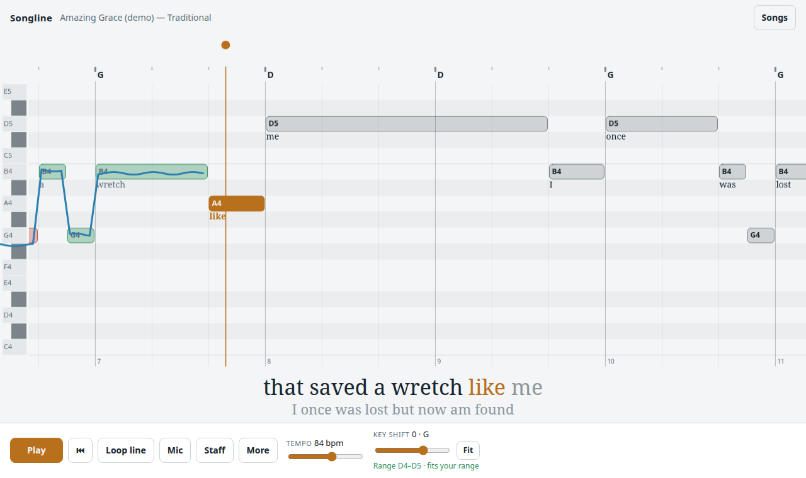
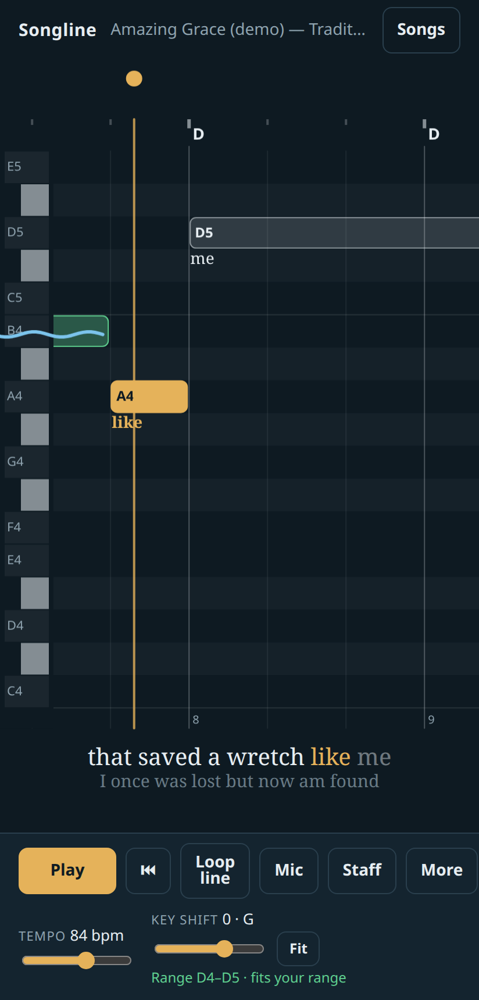
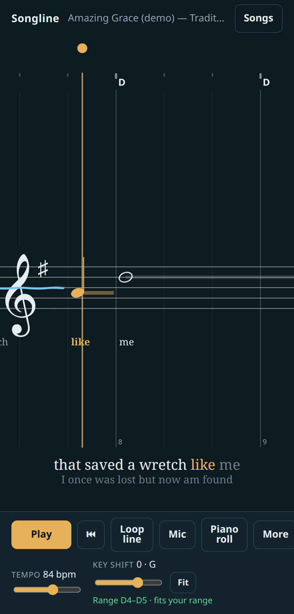
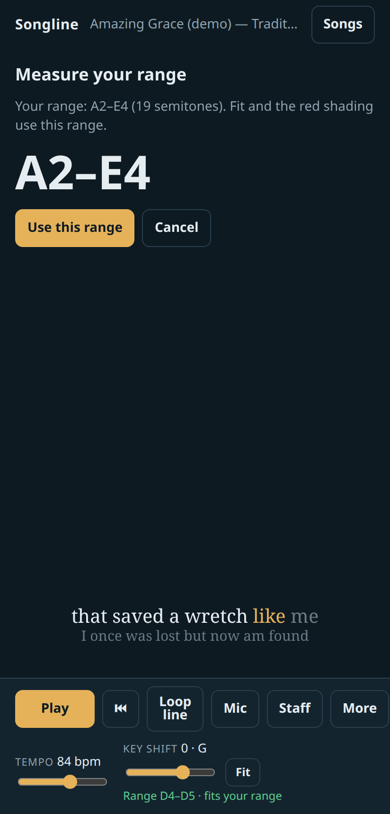
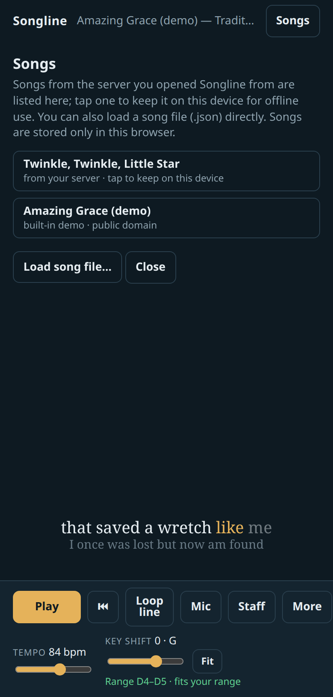

# Songline

A sing-along practice app. Songline scrolls the melody of a song across the
screen as a piano roll or on a staff, with the lyrics under the notes and a
karaoke line below. A sampled piano plays the tune and its chords while a
bouncing ball keeps the beat. Turn on the microphone and it draws the pitch
you're singing over the melody and tells you how close you were.

It runs in any modern browser, on a computer or a phone. You can install it to
your home screen, and once a song is on your device it works offline.

**Try it: <https://mbhewitt.github.io/songline/>.** This is an example copy
with the bundled public-domain songs. Open it on your phone and tap **Install**
(or the browser menu's *Add to Home screen*) to install it like an app.

<p>
  
</p>
<p>
  
  
  
  
</p>

## Features

- **Two views.** A piano roll (note names on the bars) or a scrolling staff with
  a proper key signature. Tap **Staff** / **Piano roll** to switch.
- **Guide piano and chords.** A sampled grand piano plays the melody, with
  chords underneath. Each has its own volume.
- **Karaoke lyrics.** Words sit under their notes on the score. Below it, the
  current line lights up word by word, with the next line shown underneath.
- **Bouncing ball and count-in.** Optional metronome click.
- **Live pitch.** **Mic** draws what you sing as a line over the melody. Each
  note turns green, amber or red depending on how close you held it, and you get
  a score at the end. **Any octave** scores a note sung an octave away as
  correct, so a low voice can practise a high song.
- **Key shift and your range.** Shift the song up or down by semitones. Songline
  shows the song's new lowest and highest notes and whether they fit your
  range, and **Fit** picks the best shift for you. Set your range from a voice
  type, pick the notes, or **Measure** it by singing your lowest and highest
  comfortable notes.
- **Practice tools.** Tempo control, **Loop line** to repeat the current line,
  and tap or drag the score to jump around.
- **Works offline and installs like an app.** Songs you open are kept on the
  device.

## Quick start

You need **Python 3.9 or newer**, and nothing else.

```sh
git clone https://github.com/mbhewitt/songline.git
cd songline
python3 tools/serve.py
```

Open <http://localhost:8765/> and press **Play**. The demo song is
*Amazing Grace*. Open **Songs** to see the other bundled songs. Click
**Mic** to sing along; your browser will ask for microphone permission.

If you have `make`, the same commands are available as `make run` and `make test`.

## Using it

| Control | What it does |
|---|---|
| **Play / Pause**, **⏮** | Start and stop; go back to the start. A count-in plays first (turn it off under **More**). |
| **Loop line** | Repeat the line you're on until you turn it off. |
| **Mic** | Show your sung pitch and score each note. Headphones help, because the guide piano can leak into the mic. |
| **Staff / Piano roll** | Switch views. |
| **Tempo** | Slow down or speed up. This is remembered per song. |
| **Key shift**, **Fit** | Move the song into your range. The line under the slider shows the song's range and whether it fits yours. |
| **More → Guide piano, Chords** | Volumes. Set the guide piano to *off* once you know the tune. |
| **More → My range** | A voice type (Bass … Soprano), your lowest and highest notes, or **Measure** to find them with the mic. Notes outside your range are shaded red on the piano roll. |
| **More → Click, Count-in, Any octave** | Metronome; count-in before playing; octave-free scoring. |
| Tap or drag the score | Jump to a spot / scrub. |
| Keyboard | **Space** play/pause, **L** loop line, **Home** back to the start. |
| Drop a `.json` song file on the page | Load it (same as **Songs → Load song file…**). |

### Measuring your range

**More → My range → Measure** opens a short two-step check:

1. Sing your lowest comfortable note on "ah" and hold it for a second or two.
2. Sing your highest comfortable note (not a strained one) and hold it.

Only notes you hold steady count, so slides and voice cracks are ignored. Then
press **Use this range**.

## Use it on your phone

Your phone needs to reach the computer running `serve.py`. The page must also be
served over **https**, because browsers only allow the microphone, offline mode
and *Add to Home screen* on secure pages. The one exception is `localhost` on
the same computer.

### On your home Wi-Fi

1. Find your computer's address on the network. The server prints it when you
   start it with `--host 0.0.0.0`, or use `ip addr` / `ipconfig` and look for
   something like `192.168.1.20`.
2. Make a certificate for that address (needs `openssl`):

   ```sh
   tools/make_cert.sh 192.168.1.20
   ```

   This creates `certs/` with your own small certificate authority
   (`certs/ca.crt`) and a server certificate. Keep `certs/ca.key` private.
3. Start the server on the network:

   ```sh
   python3 tools/serve.py --host 0.0.0.0 --cert certs/server.crt --key certs/server.key
   ```

4. Copy `certs/ca.crt` to the phone and install it as a trusted certificate:
   - **Android:** Settings → Security (and privacy) → More security settings →
     Encryption & credentials → Install a certificate → **CA certificate**. The
     menu names vary a little between phone makers; searching settings for
     "certificate" finds it.
   - **iPhone / iPad:** open the file to download the profile. Install it in
     Settings → General → VPN & Device Management. Then turn it on in Settings →
     General → About → Certificate Trust Settings.
5. Open `https://192.168.1.20:8765/` on the phone. To install the app, use
   **Install** in the header, or the browser menu → *Add to Home screen*.

When you open a song from **Songs**, it's saved on the phone and works offline
from then on. Later changes to that song on the computer reach the phone the
next time you open Songline while it can reach the server.

### Away from home

Use any private network that connects your phone to your computer, such as a
mesh VPN (Tailscale, ZeroTier, NordVPN Meshnet, a WireGuard tunnel to home, and
so on). Run `tools/make_cert.sh` with the computer's address or hostname on that
network; you can pass several, e.g. `tools/make_cert.sh 192.168.1.20 100.64.0.7 mypc.example`.
Start the server with `--host` set to that address (or `0.0.0.0`). Some of these
services can also give you a real https certificate (e.g. `tailscale serve`), in
which case you can skip installing `ca.crt` on the phone.

Avoid exposing the server to the public internet: anyone who can reach it can
read your songs.

### Without a server

The `app/` folder is a static website. The [example copy](https://mbhewitt.github.io/songline/)
is built by `tools/build_site.py` and published by `.github/workflows/pages.yml`
on every push to `main`; a fork can do the same by enabling GitHub Pages
(Settings → Pages → Source: GitHub Actions). Only `songs/` is published, and the
build refuses any song whose header doesn't say it's in the public domain.

On a hosted copy, load your own song `.json` files on the device with
**Songs → Load song file…**. They're stored in that browser only, never uploaded. To
make a `.json` file, see [Adding your own songs](#adding-your-own-songs). Only
publish songs you have the right to share.

## Adding your own songs

Songs are short text files, one line per bar, with the pitch, length and lyric
syllable of each note. Here is the start of `songs/twinkle_twinkle.txt`:

```text
title: Twinkle, Twinkle, Little Star
artist: Traditional
key: C
tempo: 100
time: 4/4

1  C     | C4:1:Twin- C4:1:kle G4:1:twin- G4:1:kle
2  F C   | A4:1:lit- A4:1:tle G4:2:star,
3  F C   | F4:1:how F4:1:I E4:1:won- E4:1:der
4  G C   | D4:1:what D4:1:you C4:2:are.
```

Each bar line starts with the bar number and the chord names, then `|`, then one
token per note: `PITCH:BEATS:LYRIC`. `C4` is middle C and a beat is a quarter
note. A syllable that ends in `-` continues the word. Rests are `r:BEATS`.

To add a song:

1. Make a folder called `my-songs/` next to `songs/`. It's ignored by git, so your
   own songs stay private.
2. Write `my-songs/your_song.txt`, working from sheet music you own.
3. Start (or keep running) `python3 tools/serve.py`. The server converts `.txt`
   files every time they're requested, so just reload **Songs** to see it. If
   there's a mistake, the server prints the file, line and problem, for example
   `my-songs/x.txt:12 (bar 7, pass 1): 3.5 beats, but time signature 4/4 needs 4`.

You can keep songs anywhere with `--songs DIR`, which can be repeated:
`python3 tools/serve.py --songs ~/Music/songline`.

**[docs/song-format.md](docs/song-format.md)** covers the whole format: ties,
melismas, triplets, repeats with 1st/2nd endings, per-verse lyrics, key changes
and time signature changes. It also has a step-by-step walkthrough for
transcribing from sheet music and tips for proof-reading your transcription.

Two tools help:

- `python3 tools/txt2song.py song.txt song.json` checks a song and writes the
  `.json` file that the app loads directly (for **Load song file…**).
- `python3 tools/txt2abc.py song.txt` prints the song as
  [ABC notation](https://abcnotation.com/). Paste it into an ABC viewer to see it
  as sheet music and compare it with the original.

> **Copyright.** Most published songs and sheet music are under copyright. Only
> transcribe music you have the right to use, keep personal transcriptions in
> `my-songs/` (or another private folder), and don't publish them. The songs in
> `songs/` are in the public domain.

## How it works

```
app/                 the web app: no build step, no dependencies
  index.html         layout and styles
  app.js             audio, pitch detection, drawing, karaoke, library
  sw.js              service worker (offline cache)
  samples/           piano samples (see Credits)
  demo.json          the built-in demo song (generated from songs/amazing_grace.txt)
songs/               bundled public-domain songs (.txt)
tools/
  serve.py           local server: the app plus song folders, converting .txt on the fly
  txt2song.py        song text format → song JSON (also used by serve.py)
  txt2abc.py         song text format → ABC notation, for proof-reading
  make_cert.sh       private CA + https certificate for phones
  build_site.py      static copy of the app + bundled songs (GitHub Pages)
  screenshots.py     regenerates the screenshots in this README
tests/               unit tests (Python) and browser tests (Playwright, optional)
docs/                song format guide and screenshots
```

- **Audio** uses the Web Audio API. Piano notes are sample playback, re-pitched
  from the nearest of 21 recorded notes. If the samples can't load, a simple
  synth takes over.
- **Pitch detection** uses the McLeod pitch method on the microphone signal,
  entirely in the browser. Audio never leaves the device.
- **Storage:** settings are kept in `localStorage` and songs in IndexedDB, both
  on the device only.

## Contributing

Bug reports, ideas, fixes and more public-domain songs are welcome. See
[CONTRIBUTING.md](CONTRIBUTING.md). Please follow the
[Code of Conduct](CODE_OF_CONDUCT.md).

## Credits and license

Songline is released under the [MIT License](LICENSE).

- Piano samples: [Salamander Grand Piano V3](https://archive.org/details/SalamanderGrandPianoV3)
  by Alexander Holm, licensed [CC BY 3.0](https://creativecommons.org/licenses/by/3.0/).
  They are the mp3 versions distributed with [Tone.js](https://tonejs.github.io/audio/salamander/).
  See [app/samples/README.md](app/samples/README.md).
- Bundled songs are in the public domain. Each file's header says where it comes from.
